> **What is this project about?** A quadruped robot dog that guides people around a university campus, and the localization and trajectory control that keep it on its route. This repo rebuilds that part offline from the recorded ROS 2 bags.

## TLDR

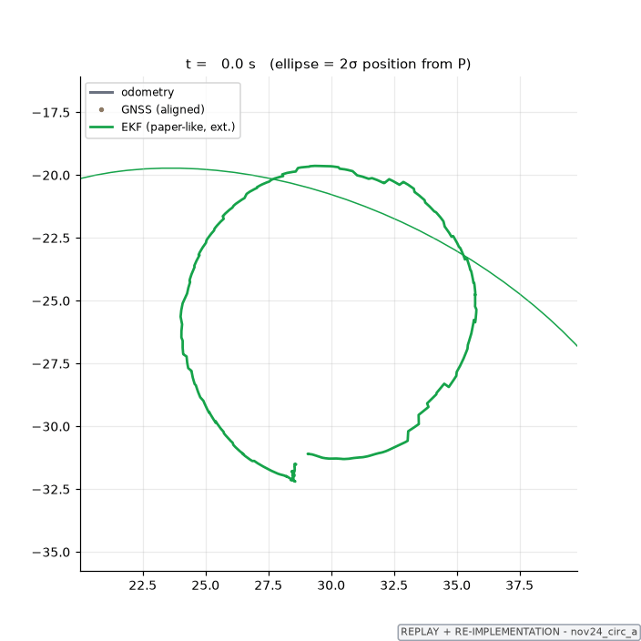

*Replay on a recorded bag (not a simulation): raw GNSS fixes at 1 Hz, odometry at ~300 Hz, and the coordinated-turn EKF estimate.*

**Problem.** FIDO (Friendly and Interactive robot DOg, Chalmers SSY226) is a Unitree Go2 that walks a planned route outdoors. It has three position sources and none is good enough alone: leg odometry is smooth but drifts and sits in its own frame, the IMU gives yaw, and GNSS is absolute but noisy (metres without RTK) and in yet another frame.

**Approach.** RTK-GNSS for centimetre-level fixes, a regression-based yaw alignment that puts GNSS and odometry in one frame, a coordinated-turn EKF that fuses them asynchronously, and an LQR that tracks a waypoint trajectory on the EKF estimate.

**Result.** On the two RTK circle runs, the aligned GNSS track is 1.8 m RMS from odometry once the alignment is gated on motion (6.8 m with the recovered rule alone), and the GNSS circle itself fits with 0.32 m residual. The EKF cuts jerk to a third or less of the raw GNSS track on straight and circular runs, but it is judged against odometry and GNSS only: there is no surveyed ground truth, so no filter accuracy is claimed. In a synthetic closed loop the recovered filter diverges and an extended version does not. Odometry is a relative baseline throughout.

My part (Adyuth Hisham Babu Syed, first author) was the RTK-GNSS setup, heading estimation, EKF sensor fusion and the LQR/LQG trajectory controller. The other parts of the project were done by teammates and are described briefly below.

## Repo map

```
README.md
Makefile            make all = tests + every figure + results.json
src/fido/           shared code: geo, heading, ekf, control, sim, plot
src/fig_*.py        one script per figure (plus extract.py, results.py, export_payload.py)
tests/              test_core.py
recovered/code/     the original on-robot code that survives (EKF, heading corrector, offline harness)
out/                figures, GIFs, and the JSON each figure's numbers come from
  results.json      every headline number with the script and bags behind it
  fido_ekf_replay.json  replay payload for a browser demo (~70 kB)
report_figs/        Figures 3 to 5 taken from the project paper
docs/deviations.md  every difference between the recovered code and the port here
data/               arrays extracted from the bags (27 MB)
```
`_extract/` (raw bags) and the original zip are not in git.

## Problems we had to solve

1. **GNSS error.** Plain GNSS is off by metres, too much for a 5 m circle or a campus path.
2. **Frames.** GNSS gives latitude/longitude. Odometry gives metres in a frame that starts at an arbitrary pose. Neither shares an origin or a heading.
3. **Fusion.** Odometry is smooth but drifts; GNSS is absolute but arrives at 1 Hz and is noisy. The two run at very different rates.
4. **Following a route.** The controller needs a position and heading estimate and has to turn it into velocity commands the Go2 accepts.
5. **Everything else.** Language-model dialogue, voice and LiDAR SLAM (teammates, see below).

## Approach we took

- **Localization (mine).** RTK status from the receiver, a sliding-window line fit of recent GNSS points to get a GNSS heading, a constant yaw offset to odometry, and an asynchronous 5-state EKF.
- **Control (mine).** A 50 Hz discrete LQR on `[x, y, yaw]`, fed by the EKF estimate instead of raw odometry.
- **Rest of the project (team).** The rest of the team worked on the dialogue and voice modules and LiDAR SLAM. No data for those is in this repo.

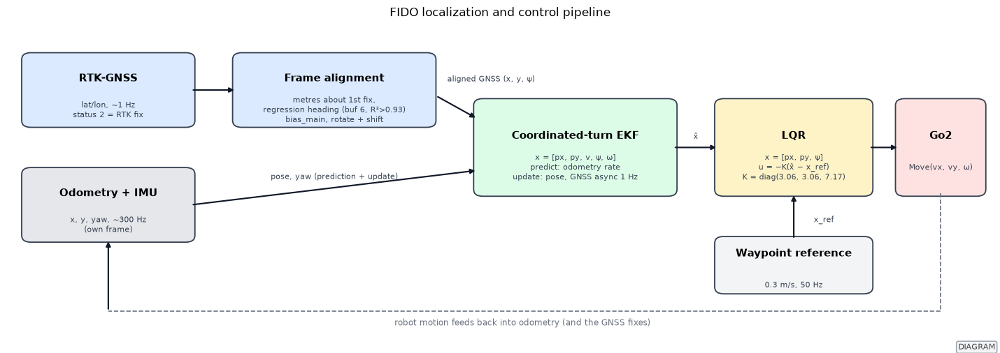
*Pipeline: RTK-GNSS, align GNSS to the odometry frame, coordinated-turn EKF fusing both, LQR tracking a waypoint trajectory on the EKF estimate.*

Each figure is labelled by how it was made: **replay** (recovered code run on the recorded bags), **re-implementation** (a port of that code in `src/fido/`) or **simulation** (synthetic closed loop).

## Our solutions

### Problem 1: GNSS error, solved with RTK
RTK uses correction data from a reference network to turn a metre-level fix into a centimetre-level one. The receiver reports it in the NavSatFix status (`2` = RTK, `0` = plain). I compared circle runs of 5 m radius with RTK off and on.

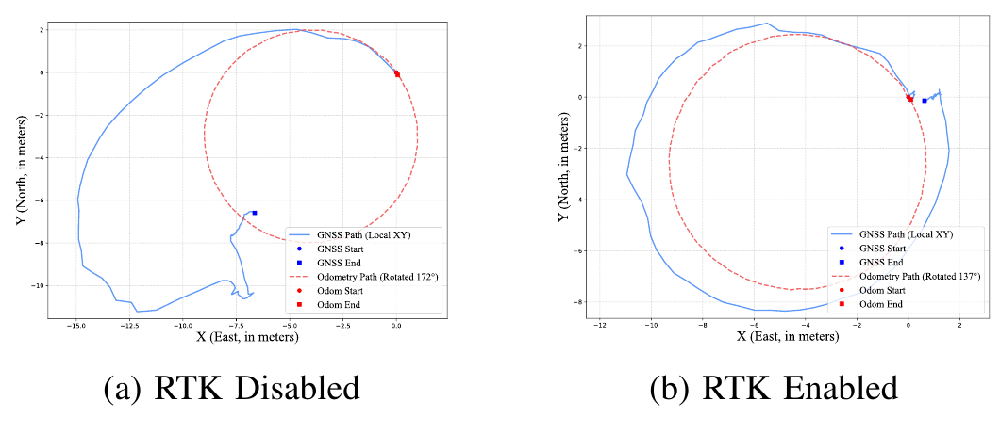
*GNSS tracking of a 5 m circle, RTK disabled (a) and enabled (b). Odometry is the local reference. Taken from the project paper.*

The same comparison replayed from the bags (5 plain runs, 2 RTK runs):

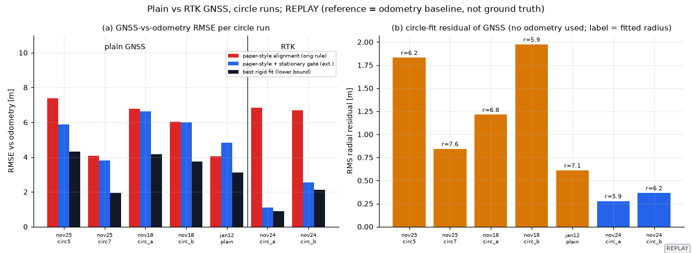
*Replay. (a) RMSE of aligned GNSS against odometry per run. (b) Residual of a circle fitted to the GNSS track alone, no odometry involved.*

| | RMSE vs odometry, recovered alignment | + stationary gate (ext.) | circle-fit residual (no odometry) |
|---|---|---|---|
| plain GNSS, 5 runs | 5.7 m | 5.4 m | 1.29 m |
| RTK, 2 runs | 6.8 m | **1.8 m** | **0.32 m** |

The circle-fit column shows RTK is clearly tighter on its own. The RMSE against odometry does not show it with the recovered alignment rule, which is the reason for problem 2.

### Problem 2: frames, solved with regression-based yaw alignment
Latitude/longitude are converted to east/north metres about the first fix. A window of the last **6** GNSS points is fitted with a line; if **R² > 0.93** its direction is a valid GNSS heading. The first valid window fixes a constant offset `bias_main = odom_yaw − gnss_heading`. GNSS points are rotated by it and shifted by the odometry position at the first fix, so both sources share a frame.

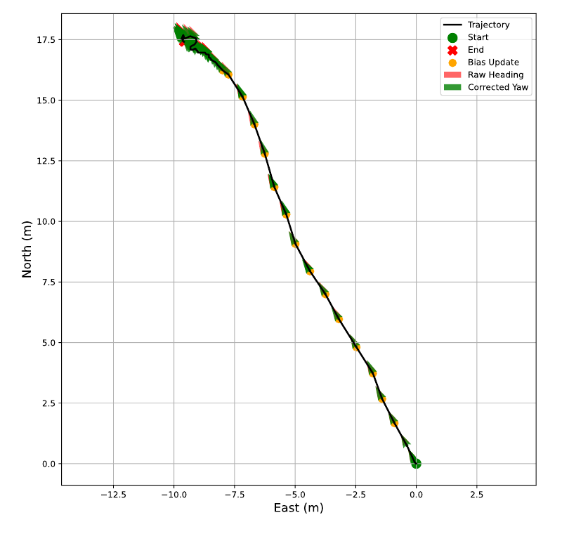
*Robot movement in the global frame and yaw corrections. Taken from the project paper.*

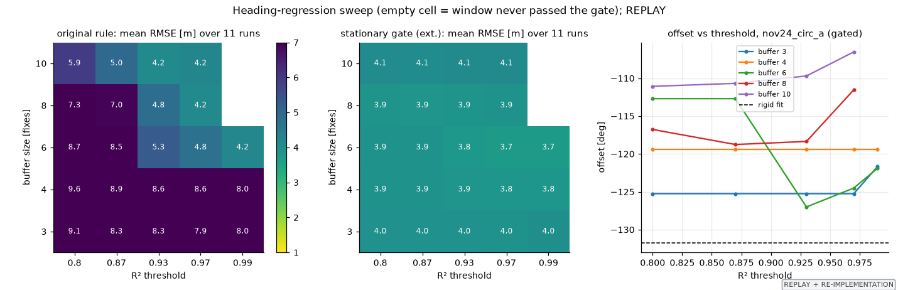
*Replay: effect of the alignment on each run.*

The recovered rule picks a wrong offset on most runs (up to about 80° from the least-squares rotation) because the window also fills while the robot stands still. Clearing the window when the robot is stationary fixes most of that. This is an extension (labelled "ext."), not recovered code. It is why the RTK runs go from 6.8 m to 1.8 m above.

### Problem 3: fusion, solved with a coordinated-turn EKF
**State** `x = [p_x, p_y, v, ψ, ω]ᵀ`: planar position, forward speed, heading, turn rate (2-D only).

**Prediction** at every odometry sample with the real `dt`, using exact arc integration with `θ = ω·dt`:
- `ω ≠ 0`: `p_x += (v/ω)(sin(ψ+θ) − sin ψ)`, `p_y += (v/ω)(cos ψ − cos(ψ+θ))`, `ψ += θ`
- `|ω| < 0.02 rad/s`: straight-line limit `p += v·dt·(cos ψ, sin ψ)`, `ψ += ω·dt`
- `v` and `ω` follow a random walk. `F` is the analytic 5×5 Jacobian, `P ← F P Fᵀ + Q·dt`.

**Measurements** both observe `[p_x, p_y, ψ]`, with heading innovations wrapped to [−π, π]:
- *Odometry pose* at every sample, with the correction scaled by `odom_reduction`. It is 0.0002 right after each GNSS fix and recovers by 0.0025 per 20 ms step up to 1.
- *GNSS pose* at ~1 Hz, asynchronously: the aligned GNSS position plus the corrected yaw, stacked with the odometry pose into one 6-dimensional update.

Nothing measures `v` or `ω`, so the recovered filter never corrects them and its prediction barely moves the robot between fixes.

**The EKF used in my replays (ext.)** is the recovered filter with three changes, none of them recovered code: (1) after each GNSS fix the odometry *cost* is raised (`R_odom / odom_red`, reset to 0.0002 and recovering by 0.000025 per 20 ms), so GNSS is trusted after a fix and odometry only gradually; (2) `v` and `ω` are set from the odometry twist at every step; (3) the heading-regression window is cleared while the robot stands still. The decay rate is my choice from a small test (`src/test_odom_schedule.py`), not the on-robot value. The unmodified filter stays in the ablation as "EKF (recovered, unchanged)".

| Quantity | Value used |
|---|---|
| GNSS noise `R_gps` (x, y, ψ) | diag(0.5, 0.5, 1.903) × 10 = diag(5, 5, 19.03) |
| Odometry pose noise `R_odom` (x, y, ψ) | diag(9, 9, 0.25) × 40 = diag(360, 360, 10) |
| Process noise `Q` | 25 for position and speed (times dt), 0.0305 rad² for ψ, 0.04 for ω |
| Initial covariance `P₀` | 10·I (my port; the original value was not recorded) |
| Heading regression | buffer 6, R² gate 0.93 |

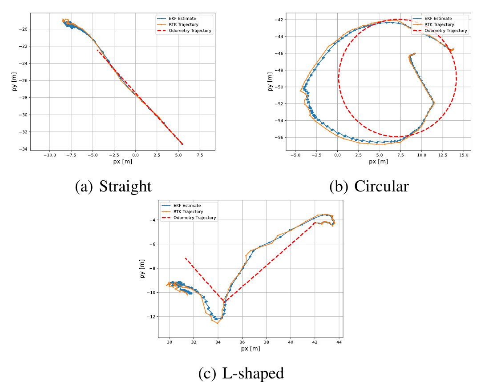
*EKF test results on straight, circular and L-shaped trajectories. Taken from the project paper.*

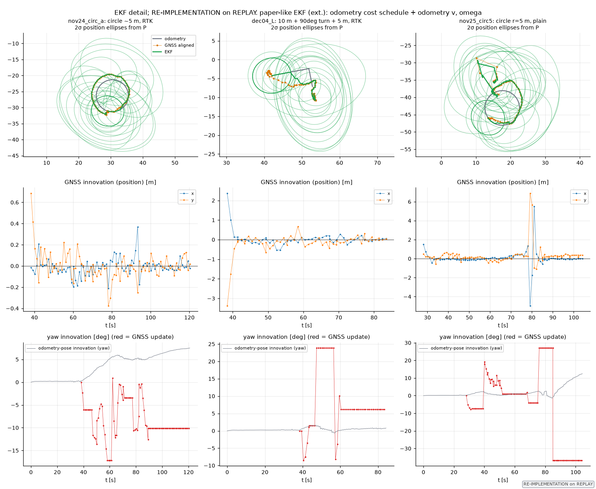
*Replay: raw GNSS, odometry and EKF (ext.) on recorded runs.*

On the straight and circular runs the EKF stays within 0.11 m and 0.16 m RMS of the RTK trajectory, and its 10 Hz jerk (0.12 m and 0.09 m) is a third or less of the GNSS track's (0.36 m and 0.40 m). The straight run's GNSS track has a roughly 2 m hook at one end that is in the data, not the filter. On the L-shaped run the EKF cuts across the second leg and ends 1.3 m RMS from the GNSS track, because the alignment is off by about 16° on that run. Averaging the first several heading windows or weighting GNSS yaw more did not fix it. I did not solve this.

Means over 12 GNSS bags (`out/ekf_summary.json`):

| | path length / odometry | jerk RMS at 10 Hz | RMS distance to odometry |
|---|---|---|---|
| odometry only | 1.0 | 0.007 m | 0 |
| EKF (recovered, unchanged) | 9.4 | 0.82 m | 3.7 m |
| **EKF (ext.)** | **1.9** | **0.21 m** | 3.4 m |

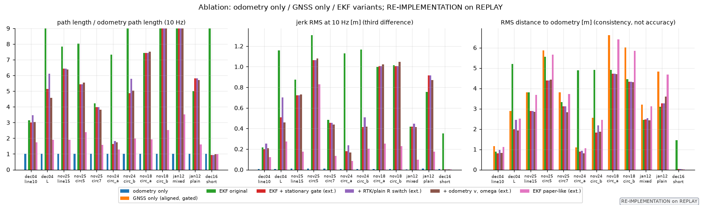
*Replay: ablation of the three changes.*

The recovered filter produces a 1 Hz sawtooth: each fix pulls the estimate to GNSS, then the odometry update pulls it back. Raising the odometry cost with the recovered decay rate made this worse. Slowing the decay and feeding odometry velocity into the prediction is what smooths it. The EKF (ext.) sits farther from odometry because it trusts GNSS more. None of these numbers measure accuracy.

**Noise calibration.** Static RTK covariance gives σ ≈ 0.05 m, against 0.71 m for the hand-set `R_gps` and 2.2 m after the ×10 inflation used on the robot. The hand-set values are conservative by more than an order of magnitude for RTK. Plain-GNSS circle residuals (1.3 m RMS) sit closer to them. A 5×5 sweep of R and Q shows trade-offs, not an optimum, since trusting odometry trivially lowers jerk and distance to odometry.

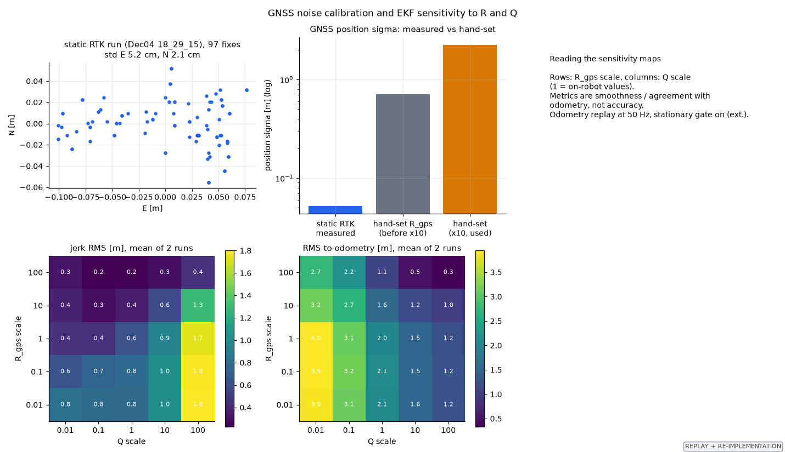
*Replay: sweep of the measurement and process noise.*

### Problem 4: following a route, solved with LQR
**State** `x = [p_x, p_y, ψ]ᵀ` from the EKF estimate. **Control** `u = [u_x, u_y, ω]ᵀ`: world-frame velocities and a yaw rate.

**Plant** (the one the code implies): discrete single integrator `x_{k+1} = A x_k + B u_k`, `A = I₃`, `B = dt·I₃`, `dt = 0.02 s`. It is holonomic, which suits the Go2 since it can strafe.

**Cost** `Σ xᵀQx + uᵀRu` with `Q = diag(10, 10, 60)` (heading weighted most) and `R = I₃`. The discrete ARE gives `K = diag(3.064, 3.064, 7.169)`. The closed loop `A − BK` has eigenvalues 0.939, 0.939, 0.857, all inside the unit circle.

**Law** `u = −K (x̂ − x_ref)` with the heading error wrapped. The world-frame `(u_x, u_y)` is rotated into the body frame by yaw and sent as `Move(v_x, v_y, ω)`. The reference `x_ref(t)` comes from a waypoint planner at 0.3 m/s sampled every 0.02 s, offset by the start pose.

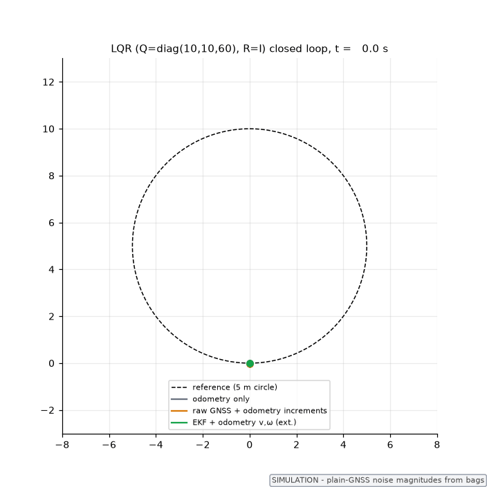
*Simulation: LQR tracking a 5 m circle on noisy estimates.*

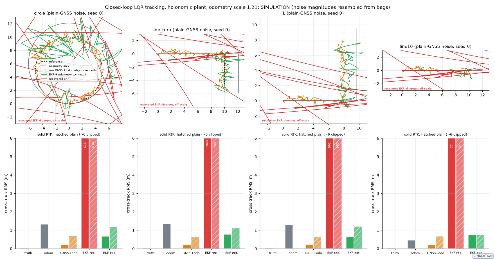
*Simulation on a circle, line plus turn, L-shape and a 10 m line. Noise magnitudes are resampled from the bags, odometry has a scale error of 1.21. Solid = RTK noise, hatched = plain-GNSS noise.*

Cross-track RMS on the 5 m circle with plain-GNSS noise: GNSS plus odometry increments 0.68 m, EKF with a gain schedule and odometry `v, ω` (ext.) 1.17 m, odometry only 1.33 m, and **the recovered EKF diverges** (about 440 m). The closed loop uses this earlier gain-schedule extension, not the EKF (ext.) of problem 3, which diverged on this holonomic plant because it cannot see sideways motion between 1 Hz fixes. These are simulation results under my noise model, not robot results.

**Recorded control logs.** Two pasted `traj_server` terminal logs hold per-cycle `vx`, `vy`, `omega`.

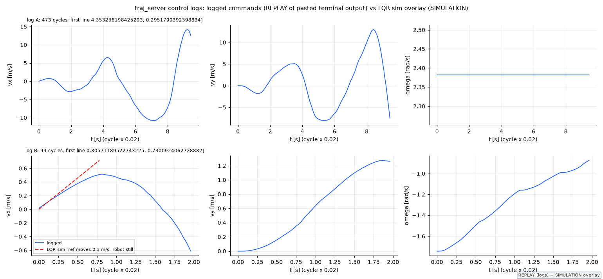
*Recorded command traces compared with the simulated controller.*

Log A shows a diverged, saturated controller (vx up to 14 m/s, omega stuck). Log B starts as an LQR would with a moving reference and a robot that has not yet moved: vx rises 0.75 m/s² (sim 0.92 m/s² with `K_x = 3.06`), then departs. The reference path behind either log was not recorded, so I could not match a simulated path to them.

### Problem 5: the rest of the project (team)
Language-model dialogue, voice interaction and LiDAR SLAM were built by teammates. There is no data for them here, so nothing in this repo reproduces them.

### Not completed
- The final on-robot code is lost. The recovered code is an earlier version.
- No ground-truth track exists, so filter accuracy is not measured.
- Trial counts and the scripts behind the paper's numbers could not be recovered.
- Position is 2-D only; indoor and outdoor operation are not fused.

## How to run

```
python -m venv .venv && .venv/bin/pip install numpy scipy pandas matplotlib pyproj rosbags pillow   # once
.venv/bin/python -I src/extract.py     # bags -> data/*.npz (needs _extract/, not in git)
make all                               # tests, every figure, out/results.json, out/fido_ekf_replay.json
```
`make all` works from `data/` alone and takes about 12 minutes (the EKF ablation dominates). Every number in this README is listed in `out/results.json` or `out/ekf_summary.json` with its script and bags.

Limits:
- This is a replay and re-implementation, not a reproduction of the robot runs. The raw bags (700 MB) are not in the repo. Figures 3 to 5 (`report_figs/`) are taken from the paper PDF in this repo.
- The paper reports 6.7 m (plain) and 1.7 m (RTK) GNSS-to-odometry RMSE. Replaying the recovered code gives 5.7 m and 6.8 m, and 5.4 m and 1.8 m with the stationary gate; the bag lists behind the paper's numbers are not recoverable.
- Differences between the paper and the recovered code (Haversine vs pyproj, LQG vs LQR class) and every change in the port are in `docs/deviations.md`.

## Team members

- **Adyuth Hisham Babu Syed** (first author; localization, RTK-GNSS, heading estimation, EKF, trajectory control: this repo)
- Four teammates (dialogue, voice, LiDAR SLAM)

Paper: [*FIDO: Integrating Robust Navigation and Interaction for a Campus Tour Guide*](SSY226_Fido_article_final.pdf), Chalmers, SSY226.
